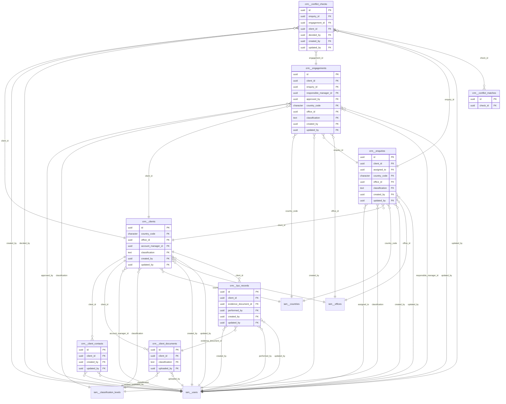
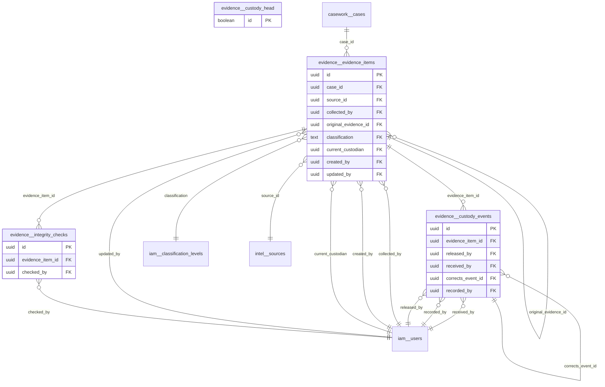
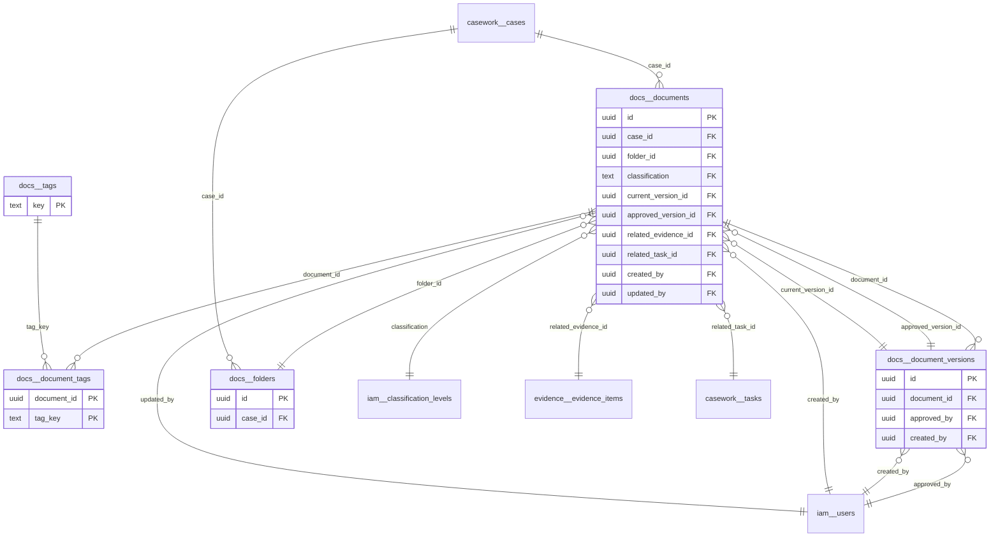
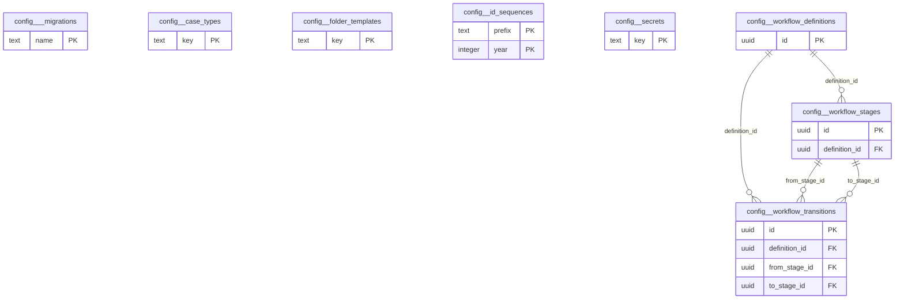
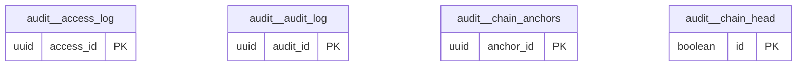

# Entity relationship diagram

Generated from the live database by `node --env-file=.env.local scripts/doc-schema.mjs`.
Do not edit by hand: re-run it after a migration instead.

Read on 2026-10-28.

## Contents

- [`iam`](#iam): 18 tables. Who people are, what they may do, and the evidence of both.
- [`crm`](#crm): 8 tables. Clients, the engagements PDDC commits to, and the intake that precedes them.
- [`casework`](#casework): 18 tables. The case record: the work, the plan, the log, safety and the commercials.
- [`evidence`](#evidence): 4 tables. 
- [`docs`](#docs): 5 tables. 
- [`intel`](#intel): 12 tables. 
- [`reporting`](#reporting): 0 tables. 
- [`notify`](#notify): 0 tables. 
- [`config`](#config): 8 tables. Things an administrator changes without a release.
- [`audit`](#audit): 4 tables. The hash-chained trail. Append-only for every application role.

## iam

Who people are, what they may do, and the evidence of both.

```mermaid
erDiagram
  iam__access_change_requests {
    uuid id PK
    uuid target_user_id FK
    uuid requested_by FK
    uuid decided_by FK
  }
  iam__classification_levels {
    text code PK
  }
  iam__countries {
    character code PK
  }
  iam__departments {
    uuid id PK
  }
  iam__features {
    text key PK
  }
  iam__login_attempts {
    uuid id PK
    uuid user_id FK
  }
  iam__offices {
    uuid id PK
    character country_code FK
  }
  iam__permissions {
    uuid id PK
    text classification_ceiling FK
  }
  iam__role_features {
    uuid role_id PK
    text feature_key PK
  }
  iam__role_incompatibilities {
    uuid role_a_id PK
    uuid role_b_id PK
  }
  iam__role_permissions {
    uuid role_id PK
    uuid permission_id PK
    uuid granted_by FK
  }
  iam__role_versions {
    uuid id PK
    uuid role_id FK
    uuid changed_by FK
  }
  iam__roles {
    uuid id PK
    uuid created_by FK
    uuid updated_by FK
  }
  iam__user_features {
    uuid user_id PK
    text feature_key PK
    uuid granted_by FK
  }
  iam__user_invitations {
    uuid id PK
    uuid invited_by FK
    text intended_clearance FK
    uuid office_id FK
    uuid department_id FK
  }
  iam__user_permission_overrides {
    uuid id PK
    uuid user_id FK
    uuid permission_id FK
    uuid granted_by FK
  }
  iam__user_roles {
    uuid id PK
    uuid user_id FK
    uuid role_id FK
    uuid assigned_by FK
  }
  iam__users {
    uuid id PK
    uuid office_id FK
    uuid department_id FK
    character country_code FK
    text clearance FK
  }
  iam__access_change_requests }o--|| iam__users : "decided_by"
  iam__access_change_requests }o--|| iam__users : "requested_by"
  iam__users ||--o{ iam__access_change_requests : "target_user_id"
  iam__login_attempts }o--|| iam__users : "user_id"
  iam__offices }o--|| iam__countries : "country_code"
  iam__permissions }o--|| iam__classification_levels : "classification_ceiling"
  iam__features ||--o{ iam__role_features : "feature_key"
  iam__roles ||--o{ iam__role_features : "role_id"
  iam__roles ||--o{ iam__role_incompatibilities : "role_a_id"
  iam__roles ||--o{ iam__role_incompatibilities : "role_b_id"
  iam__role_permissions }o--|| iam__users : "granted_by"
  iam__permissions ||--o{ iam__role_permissions : "permission_id"
  iam__roles ||--o{ iam__role_permissions : "role_id"
  iam__role_versions }o--|| iam__users : "changed_by"
  iam__roles ||--o{ iam__role_versions : "role_id"
  iam__roles }o--|| iam__users : "created_by"
  iam__roles }o--|| iam__users : "updated_by"
  iam__features ||--o{ iam__user_features : "feature_key"
  iam__user_features }o--|| iam__users : "granted_by"
  iam__users ||--o{ iam__user_features : "user_id"
  iam__user_invitations }o--|| iam__departments : "department_id"
  iam__user_invitations }o--|| iam__classification_levels : "intended_clearance"
  iam__user_invitations }o--|| iam__users : "invited_by"
  iam__user_invitations }o--|| iam__offices : "office_id"
  iam__user_permission_overrides }o--|| iam__users : "granted_by"
  iam__permissions ||--o{ iam__user_permission_overrides : "permission_id"
  iam__users ||--o{ iam__user_permission_overrides : "user_id"
  iam__user_roles }o--|| iam__users : "assigned_by"
  iam__roles ||--o{ iam__user_roles : "role_id"
  iam__users ||--o{ iam__user_roles : "user_id"
  iam__users }o--|| iam__classification_levels : "clearance"
  iam__users }o--|| iam__countries : "country_code"
  iam__users }o--|| iam__departments : "department_id"
  auth__users ||--o{ iam__users : "id"
  iam__users }o--|| iam__offices : "office_id"
```

### `iam.access_change_requests`

Row-level security: enabled, forced, 3 policies.

| Column | Type | Null | Default |
| --- | --- | --- | --- |
| **id** | uuid | no | `extensions.gen_random_uuid()` |
| kind | text | no |  |
| target_user_id | uuid | yes |  |
| target_record | text | yes |  |
| payload | jsonb | no | `'{}'::jsonb` |
| reason | text | no |  |
| requested_by | uuid | no |  |
| requested_at | timestamp with time zone | no | `now()` |
| status | text | no | `'pending'::text` |
| decided_by | uuid | yes |  |
| decided_at | timestamp with time zone | yes |  |
| decision_note | text | yes |  |
| applied_at | timestamp with time zone | yes |  |
| expires_at | timestamp with time zone | no | `(now() + '7 days'::interval)` |

Points at:

- `decided_by` to `iam.users`
- `requested_by` to `iam.users`
- `target_user_id` to `iam.users`, cascading

### `iam.classification_levels`

Row-level security: enabled, forced, 2 policies.

| Column | Type | Null | Default |
| --- | --- | --- | --- |
| **code** | text | no |  |
| name | text | no |  |
| rank | integer | no |  |
| description | text | yes |  |
| is_active | boolean | no | `true` |

### `iam.countries`

Row-level security: enabled, forced, 2 policies.

| Column | Type | Null | Default |
| --- | --- | --- | --- |
| **code** | character | no |  |
| name | text | no |  |
| residency_note | text | yes |  |
| is_active | boolean | no | `true` |
| created_at | timestamp with time zone | no | `now()` |

### `iam.departments`

Row-level security: enabled, forced, 2 policies.

| Column | Type | Null | Default |
| --- | --- | --- | --- |
| **id** | uuid | no | `extensions.gen_random_uuid()` |
| code | text | no |  |
| name | text | no |  |
| is_active | boolean | no | `true` |
| created_at | timestamp with time zone | no | `now()` |

### `iam.features`

Row-level security: enabled, forced, 2 policies.

| Column | Type | Null | Default |
| --- | --- | --- | --- |
| **key** | text | no |  |
| name | text | no |  |
| description | text | yes |  |
| is_active | boolean | no | `true` |

### `iam.login_attempts`

Row-level security: enabled, forced, 1 policy.

| Column | Type | Null | Default |
| --- | --- | --- | --- |
| **id** | uuid | no | `extensions.gen_random_uuid()` |
| email | USER-DEFINED | no |  |
| user_id | uuid | yes |  |
| succeeded | boolean | no |  |
| failure_kind | text | yes |  |
| ip | inet | yes |  |
| user_agent | text | yes |  |
| attempted_at | timestamp with time zone | no | `now()` |

Points at:

- `user_id` to `iam.users`, set null

### `iam.offices`

Row-level security: enabled, forced, 2 policies.

| Column | Type | Null | Default |
| --- | --- | --- | --- |
| **id** | uuid | no | `extensions.gen_random_uuid()` |
| code | text | no |  |
| name | text | no |  |
| country_code | character | no |  |
| timezone | text | no | `'UTC'::text` |
| is_active | boolean | no | `true` |
| created_at | timestamp with time zone | no | `now()` |

Points at:

- `country_code` to `iam.countries`

### `iam.permissions`

Row-level security: enabled, forced, 2 policies.

| Column | Type | Null | Default |
| --- | --- | --- | --- |
| **id** | uuid | no | `extensions.gen_random_uuid()` |
| resource | text | no |  |
| action | text | no |  |
| scope | text | no | `'assigned'::text` |
| classification_ceiling | text | no | `'INTERNAL'::text` |
| description | text | yes |  |
| created_at | timestamp with time zone | no | `now()` |

Points at:

- `classification_ceiling` to `iam.classification_levels`

### `iam.role_features`

Row-level security: enabled, forced, 2 policies.

| Column | Type | Null | Default |
| --- | --- | --- | --- |
| **role_id** | uuid | no |  |
| **feature_key** | text | no |  |
| enabled | boolean | no | `true` |

Points at:

- `feature_key` to `iam.features`, cascading
- `role_id` to `iam.roles`, cascading

### `iam.role_incompatibilities`

Row-level security: enabled, forced, 2 policies.

| Column | Type | Null | Default |
| --- | --- | --- | --- |
| **role_a_id** | uuid | no |  |
| **role_b_id** | uuid | no |  |
| reason | text | no |  |
| created_at | timestamp with time zone | no | `now()` |

Points at:

- `role_a_id` to `iam.roles`, cascading
- `role_b_id` to `iam.roles`, cascading

### `iam.role_permissions`

Row-level security: enabled, forced, 2 policies.

| Column | Type | Null | Default |
| --- | --- | --- | --- |
| **role_id** | uuid | no |  |
| **permission_id** | uuid | no |  |
| granted_at | timestamp with time zone | no | `now()` |
| granted_by | uuid | yes |  |

Points at:

- `granted_by` to `iam.users`
- `permission_id` to `iam.permissions`, cascading
- `role_id` to `iam.roles`, cascading

### `iam.role_versions`

Row-level security: enabled, forced, 2 policies.

| Column | Type | Null | Default |
| --- | --- | --- | --- |
| **id** | uuid | no | `extensions.gen_random_uuid()` |
| role_id | uuid | no |  |
| version | integer | no |  |
| reason | text | no |  |
| before_value | jsonb | yes |  |
| after_value | jsonb | no |  |
| changed_by | uuid | yes |  |
| changed_at | timestamp with time zone | no | `now()` |

Points at:

- `changed_by` to `iam.users`
- `role_id` to `iam.roles`, cascading

### `iam.roles`

Row-level security: enabled, forced, 2 policies.

| Column | Type | Null | Default |
| --- | --- | --- | --- |
| **id** | uuid | no | `extensions.gen_random_uuid()` |
| key | text | no |  |
| name | text | no |  |
| description | text | yes |  |
| is_baseline | boolean | no | `false` |
| is_administrator | boolean | no | `false` |
| is_active | boolean | no | `true` |
| created_at | timestamp with time zone | no | `now()` |
| created_by | uuid | yes |  |
| updated_at | timestamp with time zone | no | `now()` |
| updated_by | uuid | yes |  |
| version | integer | no | `1` |
| deleted_at | timestamp with time zone | yes |  |

Points at:

- `created_by` to `iam.users`
- `updated_by` to `iam.users`

### `iam.user_features`

Row-level security: enabled, forced, 2 policies.

| Column | Type | Null | Default |
| --- | --- | --- | --- |
| **user_id** | uuid | no |  |
| **feature_key** | text | no |  |
| enabled | boolean | no |  |
| reason | text | no |  |
| expires_at | timestamp with time zone | yes |  |
| granted_by | uuid | yes |  |
| granted_at | timestamp with time zone | no | `now()` |

Points at:

- `feature_key` to `iam.features`, cascading
- `granted_by` to `iam.users`
- `user_id` to `iam.users`, cascading

### `iam.user_invitations`

Row-level security: enabled, forced, 1 policy.

| Column | Type | Null | Default |
| --- | --- | --- | --- |
| **id** | uuid | no | `extensions.gen_random_uuid()` |
| email | USER-DEFINED | no |  |
| invited_by | uuid | yes |  |
| intended_roles | ARRAY | no | `'{}'::uuid[]` |
| intended_clearance | text | no | `'INTERNAL'::text` |
| office_id | uuid | yes |  |
| department_id | uuid | yes |  |
| status | text | no | `'pending'::text` |
| sent_at | timestamp with time zone | no | `now()` |
| accepted_at | timestamp with time zone | yes |  |
| expires_at | timestamp with time zone | no | `(now() + '14 days'::interval)` |
| created_at | timestamp with time zone | no | `now()` |

Points at:

- `department_id` to `iam.departments`
- `intended_clearance` to `iam.classification_levels`
- `invited_by` to `iam.users`
- `office_id` to `iam.offices`

### `iam.user_permission_overrides`

Row-level security: enabled, forced, 2 policies.

| Column | Type | Null | Default |
| --- | --- | --- | --- |
| **id** | uuid | no | `extensions.gen_random_uuid()` |
| user_id | uuid | no |  |
| permission_id | uuid | no |  |
| effect | text | no |  |
| reason | text | no |  |
| expires_at | timestamp with time zone | yes |  |
| granted_by | uuid | yes |  |
| granted_at | timestamp with time zone | no | `now()` |

Points at:

- `granted_by` to `iam.users`
- `permission_id` to `iam.permissions`, cascading
- `user_id` to `iam.users`, cascading

### `iam.user_roles`

Row-level security: enabled, forced, 2 policies.

| Column | Type | Null | Default |
| --- | --- | --- | --- |
| **id** | uuid | no | `extensions.gen_random_uuid()` |
| user_id | uuid | no |  |
| role_id | uuid | no |  |
| scope_type | text | no | `'all'::text` |
| scope_id | text | yes |  |
| is_primary | boolean | no | `false` |
| valid_from | timestamp with time zone | no | `now()` |
| valid_to | timestamp with time zone | yes |  |
| assigned_by | uuid | yes |  |
| assigned_at | timestamp with time zone | no | `now()` |
| reason | text | yes |  |

Points at:

- `assigned_by` to `iam.users`
- `role_id` to `iam.roles`, cascading
- `user_id` to `iam.users`, cascading

### `iam.users`

IIMS-side user record. Its presence is what grants access to the platform; a primaddc.com website account alone grants nothing.

Row-level security: enabled, forced, 3 policies.

| Column | Type | Null | Default |
| --- | --- | --- | --- |
| **id** | uuid | no |  |
| employee_id | text | yes |  |
| work_phone | text | yes |  |
| job_title | text | yes |  |
| office_id | uuid | yes |  |
| department_id | uuid | yes |  |
| country_code | character | yes |  |
| clearance | text | no | `'INTERNAL'::text` |
| status | text | no | `'invited'::text` |
| permissions_version | bigint | no | `1` |
| failed_login_count | integer | no | `0` |
| locked_until | timestamp with time zone | yes |  |
| session_timeout_minutes | integer | no | `480` |
| mfa_enrolled_at | timestamp with time zone | yes |  |
| last_seen_at | timestamp with time zone | yes |  |
| notes | text | yes |  |
| created_at | timestamp with time zone | no | `now()` |
| created_by | uuid | yes |  |
| updated_at | timestamp with time zone | no | `now()` |
| updated_by | uuid | yes |  |
| version | integer | no | `1` |
| deleted_at | timestamp with time zone | yes |  |

Points at:

- `clearance` to `iam.classification_levels`
- `country_code` to `iam.countries`
- `department_id` to `iam.departments`
- `id` to `auth.users`, cascading
- `office_id` to `iam.offices`

## crm

Clients, the engagements PDDC commits to, and the intake that precedes them.

### `crm.client_contacts`

Row-level security: enabled, forced, 3 policies.

| Column | Type | Null | Default |
| --- | --- | --- | --- |
| **id** | uuid | no | `gen_random_uuid()` |
| client_id | uuid | no |  |
| full_name | text | no |  |
| position | text | yes |  |
| email | USER-DEFINED | yes |  |
| telephone | text | yes |  |
| is_primary | boolean | no | `false` |
| notes | text | yes |  |
| created_at | timestamp with time zone | no | `now()` |
| created_by | uuid | yes |  |
| updated_at | timestamp with time zone | no | `now()` |
| updated_by | uuid | yes |  |
| version | integer | no | `1` |
| deleted_at | timestamp with time zone | yes |  |

Points at:

- `client_id` to `crm.clients`, cascading
- `created_by` to `iam.users`
- `updated_by` to `iam.users`

### `crm.client_documents`

Row-level security: enabled, forced, 4 policies.

| Column | Type | Null | Default |
| --- | --- | --- | --- |
| **id** | uuid | no | `gen_random_uuid()` |
| client_id | uuid | no |  |
| document_type | text | no |  |
| title | text | no |  |
| file_name | text | yes |  |
| mime_type | text | yes |  |
| file_size | bigint | yes |  |
| sha256_hash | text | yes |  |
| storage_key | text | yes |  |
| classification | text | no | `'CONFIDENTIAL'::text` |
| expires_at | date | yes |  |
| uploaded_at | timestamp with time zone | no | `now()` |
| uploaded_by | uuid | yes |  |
| deleted_at | timestamp with time zone | yes |  |

Points at:

- `classification` to `iam.classification_levels`
- `client_id` to `crm.clients`, cascading
- `uploaded_by` to `iam.users`

### `crm.clients`

Organisations PDDC works for. Client ID is CLI-YYYY-NNNNNN, allocated server-side from a sequence (PRD 8.1).

Row-level security: enabled, forced, 4 policies.

| Column | Type | Null | Default |
| --- | --- | --- | --- |
| **id** | uuid | no | `gen_random_uuid()` |
| client_id | text | no | `config.next_human_id('CLI'::text)` |
| organisation_name | text | no |  |
| organisation_name_normalised | text | yes |  |
| contact_person | text | yes |  |
| position | text | yes |  |
| telephone | text | yes |  |
| email | USER-DEFINED | yes |  |
| address | text | yes |  |
| country_code | character | yes |  |
| office_id | uuid | yes |  |
| industry | text | yes |  |
| client_type | text | no | `'corporate'::text` |
| kyc_status | text | no | `'not_started'::text` |
| kyc_completed_at | timestamp with time zone | yes |  |
| client_risk_rating | text | no | `'medium'::text` |
| account_manager_id | uuid | yes |  |
| date_onboarded | date | yes |  |
| active_status | text | no | `'prospect'::text` |
| classification | text | no | `'CONFIDENTIAL'::text` |
| notes | text | yes |  |
| created_at | timestamp with time zone | no | `now()` |
| created_by | uuid | yes |  |
| updated_at | timestamp with time zone | no | `now()` |
| updated_by | uuid | yes |  |
| version | integer | no | `1` |
| deleted_at | timestamp with time zone | yes |  |

Points at:

- `account_manager_id` to `iam.users`
- `classification` to `iam.classification_levels`
- `country_code` to `iam.countries`
- `created_by` to `iam.users`
- `office_id` to `iam.offices`
- `updated_by` to `iam.users`

### `crm.conflict_checks`

Row-level security: enabled, forced, 3 policies.

| Column | Type | Null | Default |
| --- | --- | --- | --- |
| **id** | uuid | no | `gen_random_uuid()` |
| check_id | text | no | `config.next_human_id('CFL'::text)` |
| enquiry_id | uuid | yes |  |
| engagement_id | uuid | yes |  |
| client_id | uuid | yes |  |
| searched_terms | ARRAY | no | `'{}'::text[]` |
| status | text | no | `'open'::text` |
| decision | text | yes |  |
| decision_reason | text | yes |  |
| decided_by | uuid | yes |  |
| decided_at | timestamp with time zone | yes |  |
| match_count | integer | no | `0` |
| highest_score | numeric | yes |  |
| created_at | timestamp with time zone | no | `now()` |
| created_by | uuid | yes |  |
| updated_at | timestamp with time zone | no | `now()` |
| updated_by | uuid | yes |  |
| version | integer | no | `1` |

Points at:

- `client_id` to `crm.clients`
- `created_by` to `iam.users`
- `decided_by` to `iam.users`
- `engagement_id` to `crm.engagements`
- `enquiry_id` to `crm.enquiries`
- `updated_by` to `iam.users`

### `crm.conflict_matches`

Row-level security: enabled, forced, 2 policies.

| Column | Type | Null | Default |
| --- | --- | --- | --- |
| **id** | uuid | no | `gen_random_uuid()` |
| check_id | uuid | no |  |
| searched_term | text | no |  |
| matched_table | text | no |  |
| matched_id | uuid | no |  |
| matched_label | text | no |  |
| similarity | numeric | no |  |
| phonetic_match | boolean | no | `false` |
| match_reason | text | yes |  |
| created_at | timestamp with time zone | no | `now()` |

Points at:

- `check_id` to `crm.conflict_checks`, cascading

### `crm.engagements`

Row-level security: enabled, forced, 4 policies.

| Column | Type | Null | Default |
| --- | --- | --- | --- |
| **id** | uuid | no | `gen_random_uuid()` |
| engagement_id | text | no | `config.next_human_id('ENG'::text)` |
| client_id | uuid | no |  |
| enquiry_id | uuid | yes |  |
| title | text | no |  |
| engagement_type | text | no | `'due_diligence'::text` |
| start_date | date | yes |  |
| end_date | date | yes |  |
| contract_reference | text | yes |  |
| nda_reference | text | yes |  |
| scope_of_services | text | yes |  |
| commercial_terms | text | yes |  |
| responsible_manager_id | uuid | yes |  |
| status | text | no | `'draft'::text` |
| approved_by | uuid | yes |  |
| approved_at | timestamp with time zone | yes |  |
| country_code | character | yes |  |
| office_id | uuid | yes |  |
| classification | text | no | `'CONFIDENTIAL'::text` |
| created_at | timestamp with time zone | no | `now()` |
| created_by | uuid | yes |  |
| updated_at | timestamp with time zone | no | `now()` |
| updated_by | uuid | yes |  |
| version | integer | no | `1` |
| deleted_at | timestamp with time zone | yes |  |

Points at:

- `approved_by` to `iam.users`
- `classification` to `iam.classification_levels`
- `client_id` to `crm.clients`
- `country_code` to `iam.countries`
- `created_by` to `iam.users`
- `enquiry_id` to `crm.enquiries`
- `office_id` to `iam.offices`
- `responsible_manager_id` to `iam.users`
- `updated_by` to `iam.users`

### `crm.enquiries`

Row-level security: enabled, forced, 3 policies.

| Column | Type | Null | Default |
| --- | --- | --- | --- |
| **id** | uuid | no | `gen_random_uuid()` |
| enquiry_id | text | no | `config.next_human_id('ENQ'::text)` |
| received_at | timestamp with time zone | no | `now()` |
| received_via | text | no | `'email'::text` |
| client_id | uuid | yes |  |
| prospect_name | text | yes |  |
| contact_name | text | yes |  |
| contact_email | USER-DEFINED | yes |  |
| contact_phone | text | yes |  |
| subject | text | no |  |
| summary | text | yes |  |
| requested_service | text | yes |  |
| urgency | text | no | `'normal'::text` |
| status | text | no | `'new'::text` |
| decline_reason | text | yes |  |
| assigned_to | uuid | yes |  |
| country_code | character | yes |  |
| office_id | uuid | yes |  |
| classification | text | no | `'CONFIDENTIAL'::text` |
| created_at | timestamp with time zone | no | `now()` |
| created_by | uuid | yes |  |
| updated_at | timestamp with time zone | no | `now()` |
| updated_by | uuid | yes |  |
| version | integer | no | `1` |

Points at:

- `assigned_to` to `iam.users`
- `classification` to `iam.classification_levels`
- `client_id` to `crm.clients`
- `country_code` to `iam.countries`
- `created_by` to `iam.users`
- `office_id` to `iam.offices`
- `updated_by` to `iam.users`

### `crm.kyc_records`

Row-level security: enabled, forced, 3 policies.

| Column | Type | Null | Default |
| --- | --- | --- | --- |
| **id** | uuid | no | `gen_random_uuid()` |
| client_id | uuid | no |  |
| check_type | text | no |  |
| outcome | text | no | `'pending'::text` |
| summary | text | yes |  |
| evidence_document_id | uuid | yes |  |
| performed_by | uuid | yes |  |
| performed_at | timestamp with time zone | yes |  |
| expires_at | date | yes |  |
| created_at | timestamp with time zone | no | `now()` |
| created_by | uuid | yes |  |
| updated_at | timestamp with time zone | no | `now()` |
| updated_by | uuid | yes |  |
| version | integer | no | `1` |

Points at:

- `client_id` to `crm.clients`, cascading
- `created_by` to `iam.users`
- `evidence_document_id` to `crm.client_documents`
- `performed_by` to `iam.users`
- `updated_by` to `iam.users`

## casework

The case record: the work, the plan, the log, safety and the commercials.

```mermaid
erDiagram
  casework__activities {
    uuid id PK
    uuid case_id FK
    uuid related_task_id FK
    uuid corrects_activity_id FK
    text classification FK
    uuid recorded_by FK
  }
  casework__case_assignments {
    uuid id PK
    uuid case_id FK
    uuid user_id FK
    uuid assigned_by FK
    uuid unassigned_by FK
  }
  casework__case_communications {
    uuid id PK
    uuid case_id FK
    text classification FK
    uuid created_by FK
    uuid updated_by FK
  }
  casework__case_financials {
    uuid id PK
    uuid case_id FK
    uuid created_by FK
    uuid updated_by FK
  }
  casework__case_objectives {
    uuid id PK
    uuid case_id FK
    uuid created_by FK
    uuid updated_by FK
  }
  casework__cases {
    uuid id PK
    uuid client_id FK
    uuid engagement_id FK
    text case_type FK
    character jurisdiction_country FK
    uuid office_id FK
    uuid definition_id FK
    uuid stage_id FK
    text classification FK
    uuid closed_by FK
    uuid created_by FK
    uuid updated_by FK
    uuid objective_override_by FK
  }
  casework__check_ins {
    uuid id PK
    uuid case_id FK
    uuid user_id FK
    uuid recorded_by FK
  }
  casework__expenses {
    uuid id PK
    uuid case_id FK
    uuid incurred_by FK
    uuid decided_by FK
    uuid created_by FK
    uuid updated_by FK
  }
  casework__incidents {
    uuid id PK
    uuid case_id FK
    uuid affected_user_id FK
    uuid resolved_by FK
    text classification FK
    uuid reported_by FK
    uuid created_by FK
    uuid updated_by FK
  }
  casework__investigation_plans {
    uuid id PK
    uuid case_id FK
    uuid created_by FK
  }
  casework__plan_versions {
    uuid id PK
    uuid plan_id FK
    uuid submitted_by FK
    uuid reviewed_by FK
    uuid created_by FK
    uuid updated_by FK
  }
  casework__risk_assessments {
    uuid id PK
    uuid case_id FK
    uuid assessed_by FK
    uuid approved_by FK
  }
  casework__safety_plans {
    uuid id PK
    uuid case_id FK
    uuid created_by FK
    uuid updated_by FK
  }
  casework__scope_change_requests {
    uuid id PK
    uuid case_id FK
    uuid requested_by FK
    uuid approving_officer FK
    uuid resulting_version_id FK
    uuid updated_by FK
  }
  casework__scope_versions {
    uuid id PK
    uuid case_id FK
    uuid change_request_id FK
    uuid created_by FK
  }
  casework__task_comments {
    uuid id PK
    uuid task_id FK
    uuid created_by FK
    uuid updated_by FK
  }
  casework__tasks {
    uuid id PK
    uuid case_id FK
    uuid assigned_to FK
    uuid parent_task_id FK
    uuid plan_version_id FK
    uuid created_by FK
    uuid updated_by FK
  }
  casework__time_entries {
    uuid id PK
    uuid case_id FK
    uuid user_id FK
    uuid task_id FK
    uuid approved_by FK
    uuid created_by FK
    uuid updated_by FK
  }
  casework__cases ||--o{ casework__activities : "case_id"
  casework__activities }o--|| iam__classification_levels : "classification"
  casework__activities }o--|| casework__activities : "corrects_activity_id"
  casework__activities }o--|| iam__users : "recorded_by"
  casework__activities }o--|| casework__tasks : "related_task_id"
  casework__case_assignments }o--|| iam__users : "assigned_by"
  casework__cases ||--o{ casework__case_assignments : "case_id"
  casework__case_assignments }o--|| iam__users : "unassigned_by"
  casework__case_assignments }o--|| iam__users : "user_id"
  casework__cases ||--o{ casework__case_communications : "case_id"
  casework__case_communications }o--|| iam__classification_levels : "classification"
  casework__case_communications }o--|| iam__users : "created_by"
  casework__case_communications }o--|| iam__users : "updated_by"
  casework__cases ||--o{ casework__case_financials : "case_id"
  casework__case_financials }o--|| iam__users : "created_by"
  casework__case_financials }o--|| iam__users : "updated_by"
  casework__cases ||--o{ casework__case_objectives : "case_id"
  casework__case_objectives }o--|| iam__users : "created_by"
  casework__case_objectives }o--|| iam__users : "updated_by"
  casework__cases }o--|| config__case_types : "case_type"
  casework__cases }o--|| iam__classification_levels : "classification"
  casework__cases }o--|| crm__clients : "client_id"
  casework__cases }o--|| iam__users : "closed_by"
  casework__cases }o--|| iam__users : "created_by"
  casework__cases }o--|| config__workflow_definitions : "definition_id"
  casework__cases }o--|| crm__engagements : "engagement_id"
  casework__cases }o--|| iam__countries : "jurisdiction_country"
  casework__cases }o--|| iam__users : "objective_override_by"
  casework__cases }o--|| iam__offices : "office_id"
  casework__cases }o--|| config__workflow_stages : "stage_id"
  casework__cases }o--|| iam__users : "updated_by"
  casework__cases ||--o{ casework__check_ins : "case_id"
  casework__check_ins }o--|| iam__users : "recorded_by"
  casework__check_ins }o--|| iam__users : "user_id"
  casework__cases ||--o{ casework__expenses : "case_id"
  casework__expenses }o--|| iam__users : "created_by"
  casework__expenses }o--|| iam__users : "decided_by"
  casework__expenses }o--|| iam__users : "incurred_by"
  casework__expenses }o--|| iam__users : "updated_by"
  casework__incidents }o--|| iam__users : "affected_user_id"
  casework__cases ||--o{ casework__incidents : "case_id"
  casework__incidents }o--|| iam__classification_levels : "classification"
  casework__incidents }o--|| iam__users : "created_by"
  casework__incidents }o--|| iam__users : "reported_by"
  casework__incidents }o--|| iam__users : "resolved_by"
  casework__incidents }o--|| iam__users : "updated_by"
  casework__cases ||--o{ casework__investigation_plans : "case_id"
  casework__investigation_plans }o--|| iam__users : "created_by"
  casework__plan_versions }o--|| iam__users : "created_by"
  casework__investigation_plans ||--o{ casework__plan_versions : "plan_id"
  casework__plan_versions }o--|| iam__users : "reviewed_by"
  casework__plan_versions }o--|| iam__users : "submitted_by"
  casework__plan_versions }o--|| iam__users : "updated_by"
  casework__risk_assessments }o--|| iam__users : "approved_by"
  casework__risk_assessments }o--|| iam__users : "assessed_by"
  casework__cases ||--o{ casework__risk_assessments : "case_id"
  casework__cases ||--o{ casework__safety_plans : "case_id"
  casework__safety_plans }o--|| iam__users : "created_by"
  casework__safety_plans }o--|| iam__users : "updated_by"
  casework__scope_change_requests }o--|| iam__users : "approving_officer"
  casework__cases ||--o{ casework__scope_change_requests : "case_id"
  casework__scope_change_requests }o--|| iam__users : "requested_by"
  casework__scope_change_requests }o--|| casework__scope_versions : "resulting_version_id"
  casework__scope_change_requests }o--|| iam__users : "updated_by"
  casework__cases ||--o{ casework__scope_versions : "case_id"
  casework__scope_versions }o--|| casework__scope_change_requests : "change_request_id"
  casework__scope_versions }o--|| iam__users : "created_by"
  casework__task_comments }o--|| iam__users : "created_by"
  casework__tasks ||--o{ casework__task_comments : "task_id"
  casework__task_comments }o--|| iam__users : "updated_by"
  casework__tasks }o--|| iam__users : "assigned_to"
  casework__cases ||--o{ casework__tasks : "case_id"
  casework__tasks }o--|| iam__users : "created_by"
  casework__tasks ||--o{ casework__tasks : "parent_task_id"
  casework__tasks }o--|| casework__plan_versions : "plan_version_id"
  casework__tasks }o--|| iam__users : "updated_by"
  casework__time_entries }o--|| iam__users : "approved_by"
  casework__cases ||--o{ casework__time_entries : "case_id"
  casework__time_entries }o--|| iam__users : "created_by"
  casework__time_entries }o--|| casework__tasks : "task_id"
  casework__time_entries }o--|| iam__users : "updated_by"
  casework__time_entries }o--|| iam__users : "user_id"
```

### `casework.activities`

What investigators did, chronologically and append-only (PRD 9.4). A correction is a new row pointing at the original through corrects_activity_id; the original is never altered.

Row-level security: enabled, forced, 2 policies.

| Column | Type | Null | Default |
| --- | --- | --- | --- |
| **id** | uuid | no | `gen_random_uuid()` |
| activity_id | text | no | `config.next_human_id('ACT'::text)` |
| case_id | uuid | no |  |
| occurred_at | timestamp with time zone | no | `now()` |
| activity_type | text | no |  |
| description | text | no |  |
| location | text | yes |  |
| related_source_id | uuid | yes |  |
| related_evidence_id | uuid | yes |  |
| related_document_id | uuid | yes |  |
| related_task_id | uuid | yes |  |
| corrects_activity_id | uuid | yes |  |
| correction_reason | text | yes |  |
| classification | text | no | `'CONFIDENTIAL'::text` |
| recorded_at | timestamp with time zone | no | `now()` |
| recorded_by | uuid | yes |  |
| seq | bigint | no | `nextval('casework.activities_seq_seq'::regclass)` |

Points at:

- `case_id` to `casework.cases`, cascading
- `classification` to `iam.classification_levels`
- `corrects_activity_id` to `casework.activities`
- `recorded_by` to `iam.users`
- `related_task_id` to `casework.tasks`

### `casework.case_assignments`

Row-level security: enabled, forced, 3 policies.

| Column | Type | Null | Default |
| --- | --- | --- | --- |
| **id** | uuid | no | `gen_random_uuid()` |
| case_id | uuid | no |  |
| user_id | uuid | no |  |
| role | text | no |  |
| assigned_at | timestamp with time zone | no | `now()` |
| assigned_by | uuid | yes |  |
| reason | text | yes |  |
| unassigned_at | timestamp with time zone | yes |  |
| unassigned_by | uuid | yes |  |
| unassign_reason | text | yes |  |

Points at:

- `assigned_by` to `iam.users`
- `case_id` to `casework.cases`, cascading
- `unassigned_by` to `iam.users`
- `user_id` to `iam.users`

### `casework.case_communications`

Row-level security: enabled, forced, 4 policies.

| Column | Type | Null | Default |
| --- | --- | --- | --- |
| **id** | uuid | no | `gen_random_uuid()` |
| case_id | uuid | no |  |
| occurred_at | timestamp with time zone | no | `now()` |
| direction | text | no |  |
| kind | text | no |  |
| channel | text | no | `'email'::text` |
| sender | text | no |  |
| recipient | text | no |  |
| subject | text | no |  |
| body | text | yes |  |
| attachment_reference | text | yes |  |
| related_task_id | uuid | yes |  |
| classification | text | no | `'CONFIDENTIAL'::text` |
| created_at | timestamp with time zone | no | `now()` |
| created_by | uuid | yes |  |
| updated_at | timestamp with time zone | no | `now()` |
| updated_by | uuid | yes |  |
| version | integer | no | `1` |
| deleted_at | timestamp with time zone | yes |  |

Points at:

- `case_id` to `casework.cases`, cascading
- `classification` to `iam.classification_levels`
- `created_by` to `iam.users`
- `updated_by` to `iam.users`

### `casework.case_financials`

PRD 5.6 case commercials. Deliberately not an accounting system: quoted, approved, invoiced, paid and outstanding, nothing more.

Row-level security: enabled, forced, 3 policies.

| Column | Type | Null | Default |
| --- | --- | --- | --- |
| **id** | uuid | no | `gen_random_uuid()` |
| case_id | uuid | no |  |
| currency | character | no | `'GHS'::bpchar` |
| quoted_fee | numeric | yes |  |
| approved_fee | numeric | yes |  |
| additional_fees | numeric | no | `0` |
| invoice_number | text | yes |  |
| amount_invoiced | numeric | no | `0` |
| amount_paid | numeric | no | `0` |
| outstanding | numeric | yes |  |
| payment_status | text | no | `'not_invoiced'::text` |
| notes | text | yes |  |
| created_at | timestamp with time zone | no | `now()` |
| created_by | uuid | yes |  |
| updated_at | timestamp with time zone | no | `now()` |
| updated_by | uuid | yes |  |
| version | integer | no | `1` |

Points at:

- `case_id` to `casework.cases`, cascading
- `created_by` to `iam.users`
- `updated_by` to `iam.users`

### `casework.case_objectives`

Row-level security: enabled, forced, 3 policies.

| Column | Type | Null | Default |
| --- | --- | --- | --- |
| **id** | uuid | no | `gen_random_uuid()` |
| case_id | uuid | no |  |
| client_instruction | text | yes |  |
| objective | text | no |  |
| questions | ARRAY | no | `'{}'::text[]` |
| deliverables | ARRAY | no | `'{}'::text[]` |
| deadline | timestamp with time zone | yes |  |
| created_at | timestamp with time zone | no | `now()` |
| created_by | uuid | yes |  |
| updated_at | timestamp with time zone | no | `now()` |
| updated_by | uuid | yes |  |
| version | integer | no | `1` |

Points at:

- `case_id` to `casework.cases`, cascading
- `created_by` to `iam.users`
- `updated_by` to `iam.users`

### `casework.cases`

The investigation itself. Case ID is PDDC-YYYY-NNNNNN, allocated server-side from a sequence (PRD 5). A case belongs to an engagement, not directly to a client.

Row-level security: enabled, forced, 4 policies.

| Column | Type | Null | Default |
| --- | --- | --- | --- |
| **id** | uuid | no | `gen_random_uuid()` |
| case_id | text | no | `config.next_human_id('PDDC'::text)` |
| title | text | no |  |
| client_id | uuid | no |  |
| engagement_id | uuid | no |  |
| case_type | text | no |  |
| jurisdiction_country | character | yes |  |
| jurisdiction_region | text | yes |  |
| office_id | uuid | yes |  |
| priority | text | no | `'medium'::text` |
| risk_level | text | no | `'medium'::text` |
| definition_id | uuid | no |  |
| stage_id | uuid | no |  |
| opened_at | timestamp with time zone | no | `now()` |
| target_completion_at | timestamp with time zone | yes |  |
| actual_completion_at | timestamp with time zone | yes |  |
| classification | text | no | `'CONFIDENTIAL'::text` |
| retention_class | text | yes |  |
| closure_summary | text | yes |  |
| closed_by | uuid | yes |  |
| closed_at | timestamp with time zone | yes |  |
| created_at | timestamp with time zone | no | `now()` |
| created_by | uuid | yes |  |
| updated_at | timestamp with time zone | no | `now()` |
| updated_by | uuid | yes |  |
| version | integer | no | `1` |
| deleted_at | timestamp with time zone | yes |  |
| objective_override_reason | text | yes |  |
| objective_override_by | uuid | yes |  |
| objective_override_at | timestamp with time zone | yes |  |

Points at:

- `case_type` to `config.case_types`
- `classification` to `iam.classification_levels`
- `client_id` to `crm.clients`
- `closed_by` to `iam.users`
- `created_by` to `iam.users`
- `definition_id` to `config.workflow_definitions`
- `engagement_id` to `crm.engagements`
- `jurisdiction_country` to `iam.countries`
- `objective_override_by` to `iam.users`
- `office_id` to `iam.offices`
- `stage_id` to `config.workflow_stages`
- `updated_by` to `iam.users`

### `casework.check_ins`

PRD 5.8 check-in and check-out events. Insert-only: a safety record somebody can revise afterwards is not a safety record.

Row-level security: enabled, forced, 2 policies.

| Column | Type | Null | Default |
| --- | --- | --- | --- |
| **id** | uuid | no | `gen_random_uuid()` |
| check_in_id | text | no | `config.next_human_id('CHK'::text)` |
| case_id | uuid | no |  |
| user_id | uuid | no |  |
| event | text | no |  |
| occurred_at | timestamp with time zone | no | `now()` |
| location | text | yes |  |
| latitude | numeric | yes |  |
| longitude | numeric | yes |  |
| next_due_at | timestamp with time zone | yes |  |
| is_safe | boolean | no | `true` |
| notes | text | yes |  |
| recorded_at | timestamp with time zone | no | `now()` |
| recorded_by | uuid | yes |  |
| seq | bigint | no | `nextval('casework.check_ins_seq_seq'::regclass)` |

Points at:

- `case_id` to `casework.cases`, cascading
- `recorded_by` to `iam.users`
- `user_id` to `iam.users`

### `casework.expenses`

PRD 5.7 case costs. Claimed by whoever incurred them and decided by somebody holding the financials permission, which is what stops self-approval.

Row-level security: enabled, forced, 3 policies.

| Column | Type | Null | Default |
| --- | --- | --- | --- |
| **id** | uuid | no | `gen_random_uuid()` |
| expense_id | text | no | `config.next_human_id('EXP'::text)` |
| case_id | uuid | no |  |
| incurred_on | date | no |  |
| category | text | no |  |
| description | text | no |  |
| amount | numeric | no |  |
| currency | character | no | `'GHS'::bpchar` |
| is_billable | boolean | no | `true` |
| receipt_reference | text | yes |  |
| incurred_by | uuid | yes |  |
| status | text | no | `'claimed'::text` |
| decided_at | timestamp with time zone | yes |  |
| decided_by | uuid | yes |  |
| decision_reason | text | yes |  |
| created_at | timestamp with time zone | no | `now()` |
| created_by | uuid | yes |  |
| updated_at | timestamp with time zone | no | `now()` |
| updated_by | uuid | yes |  |
| version | integer | no | `1` |

Points at:

- `case_id` to `casework.cases`, cascading
- `created_by` to `iam.users`
- `decided_by` to `iam.users`
- `incurred_by` to `iam.users`
- `updated_by` to `iam.users`

### `casework.incidents`

PRD 5.8 incident reports. Editable through a lifecycle, and closing one needs a resolution somebody can read.

Row-level security: enabled, forced, 3 policies.

| Column | Type | Null | Default |
| --- | --- | --- | --- |
| **id** | uuid | no | `gen_random_uuid()` |
| incident_id | text | no | `config.next_human_id('INC'::text)` |
| case_id | uuid | no |  |
| occurred_at | timestamp with time zone | no |  |
| incident_type | text | no |  |
| severity | text | no |  |
| location | text | yes |  |
| description | text | no |  |
| immediate_action | text | yes |  |
| injuries | boolean | no | `false` |
| injury_detail | text | yes |  |
| police_notified | boolean | no | `false` |
| police_reference | text | yes |  |
| affected_user_id | uuid | yes |  |
| status | text | no | `'open'::text` |
| resolution | text | yes |  |
| resolved_at | timestamp with time zone | yes |  |
| resolved_by | uuid | yes |  |
| classification | text | no |  |
| reported_at | timestamp with time zone | no | `now()` |
| reported_by | uuid | yes |  |
| created_at | timestamp with time zone | no | `now()` |
| created_by | uuid | yes |  |
| updated_at | timestamp with time zone | no | `now()` |
| updated_by | uuid | yes |  |
| version | integer | no | `1` |

Points at:

- `affected_user_id` to `iam.users`
- `case_id` to `casework.cases`, cascading
- `classification` to `iam.classification_levels`
- `created_by` to `iam.users`
- `reported_by` to `iam.users`
- `resolved_by` to `iam.users`
- `updated_by` to `iam.users`

### `casework.investigation_plans`

Row-level security: enabled, forced, 2 policies.

| Column | Type | Null | Default |
| --- | --- | --- | --- |
| **id** | uuid | no | `gen_random_uuid()` |
| plan_id | text | no | `config.next_human_id('PLN'::text)` |
| case_id | uuid | no |  |
| created_at | timestamp with time zone | no | `now()` |
| created_by | uuid | yes |  |

Points at:

- `case_id` to `casework.cases`, cascading
- `created_by` to `iam.users`

### `casework.plan_versions`

Row-level security: enabled, forced, 3 policies.

| Column | Type | Null | Default |
| --- | --- | --- | --- |
| **id** | uuid | no | `gen_random_uuid()` |
| plan_id | uuid | no |  |
| version_no | integer | no |  |
| objective | text | no |  |
| scope | text | yes |  |
| methodology | text | no |  |
| sources_to_consult | ARRAY | no | `'{}'::text[]` |
| assigned_personnel | ARRAY | no | `'{}'::text[]` |
| timeline | text | yes |  |
| risks | text | yes |  |
| resources | text | yes |  |
| expected_deliverables | ARRAY | no | `'{}'::text[]` |
| status | text | no | `'draft'::text` |
| submitted_at | timestamp with time zone | yes |  |
| submitted_by | uuid | yes |  |
| reviewed_by | uuid | yes |  |
| reviewed_at | timestamp with time zone | yes |  |
| review_notes | text | yes |  |
| created_at | timestamp with time zone | no | `now()` |
| created_by | uuid | yes |  |
| updated_at | timestamp with time zone | no | `now()` |
| updated_by | uuid | yes |  |
| version | integer | no | `1` |

Points at:

- `created_by` to `iam.users`
- `plan_id` to `casework.investigation_plans`, cascading
- `reviewed_by` to `iam.users`
- `submitted_by` to `iam.users`
- `updated_by` to `iam.users`

### `casework.risk_assessments`

Row-level security: enabled, forced, 3 policies.

| Column | Type | Null | Default |
| --- | --- | --- | --- |
| **id** | uuid | no | `gen_random_uuid()` |
| case_id | uuid | no |  |
| operational_risk | text | no |  |
| legal_risk | text | no |  |
| reputational_risk | text | no |  |
| safety_risk | text | no |  |
| sensitivity_risk | text | no |  |
| overall_risk | text | no |  |
| rationale | text | no |  |
| assessed_by | uuid | yes |  |
| assessed_at | timestamp with time zone | no | `now()` |
| approved_by | uuid | yes |  |
| approved_at | timestamp with time zone | yes |  |
| created_at | timestamp with time zone | no | `now()` |
| seq | bigint | no | `nextval('casework.risk_assessments_seq_seq'::regclass)` |

Points at:

- `approved_by` to `iam.users`
- `assessed_by` to `iam.users`
- `case_id` to `casework.cases`, cascading

### `casework.safety_plans`

PRD 5.8 safety plan: one per case, covering location, hazards, instructions, emergency contact and the check-in schedule.

Row-level security: enabled, forced, 3 policies.

| Column | Type | Null | Default |
| --- | --- | --- | --- |
| **id** | uuid | no | `gen_random_uuid()` |
| case_id | uuid | no |  |
| location | text | no |  |
| site_visit_risk | text | no |  |
| known_hazards | text | yes |  |
| safety_instructions | text | yes |  |
| emergency_contact_name | text | no |  |
| emergency_contact_phone | text | no |  |
| emergency_contact_note | text | yes |  |
| check_in_frequency_hours | integer | yes |  |
| check_in_instructions | text | yes |  |
| is_active | boolean | no | `true` |
| created_at | timestamp with time zone | no | `now()` |
| created_by | uuid | yes |  |
| updated_at | timestamp with time zone | no | `now()` |
| updated_by | uuid | yes |  |
| version | integer | no | `1` |

Points at:

- `case_id` to `casework.cases`, cascading
- `created_by` to `iam.users`
- `updated_by` to `iam.users`

### `casework.scope_change_requests`

Row-level security: enabled, forced, 3 policies.

| Column | Type | Null | Default |
| --- | --- | --- | --- |
| **id** | uuid | no | `gen_random_uuid()` |
| change_id | text | no | `config.next_human_id('SCR'::text)` |
| case_id | uuid | no |  |
| reason | text | no |  |
| proposed_scope | text | no |  |
| proposed_out_of_scope | text | yes |  |
| additional_cost | numeric | yes |  |
| additional_cost_currency | character | yes |  |
| additional_days | integer | yes |  |
| client_approval_reference | text | yes |  |
| status | text | no | `'pending'::text` |
| requested_by | uuid | yes |  |
| requested_at | timestamp with time zone | no | `now()` |
| approving_officer | uuid | yes |  |
| approved_at | timestamp with time zone | yes |  |
| decision_reason | text | yes |  |
| resulting_version_id | uuid | yes |  |
| created_at | timestamp with time zone | no | `now()` |
| updated_at | timestamp with time zone | no | `now()` |
| version | integer | no | `1` |
| updated_by | uuid | yes |  |

Points at:

- `approving_officer` to `iam.users`
- `case_id` to `casework.cases`, cascading
- `requested_by` to `iam.users`
- `resulting_version_id` to `casework.scope_versions`
- `updated_by` to `iam.users`

### `casework.scope_versions`

Row-level security: enabled, forced, 2 policies.

| Column | Type | Null | Default |
| --- | --- | --- | --- |
| **id** | uuid | no | `gen_random_uuid()` |
| case_id | uuid | no |  |
| version_no | integer | no |  |
| scope | text | no |  |
| out_of_scope | text | yes |  |
| change_request_id | uuid | yes |  |
| created_at | timestamp with time zone | no | `now()` |
| created_by | uuid | yes |  |

Points at:

- `case_id` to `casework.cases`, cascading
- `change_request_id` to `casework.scope_change_requests`
- `created_by` to `iam.users`

### `casework.task_comments`

Row-level security: enabled, forced, 4 policies.

| Column | Type | Null | Default |
| --- | --- | --- | --- |
| **id** | uuid | no | `gen_random_uuid()` |
| task_id | uuid | no |  |
| body | text | no |  |
| created_at | timestamp with time zone | no | `now()` |
| created_by | uuid | yes |  |
| updated_at | timestamp with time zone | no | `now()` |
| updated_by | uuid | yes |  |
| version | integer | no | `1` |
| deleted_at | timestamp with time zone | yes |  |
| seq | bigint | no | `nextval('casework.task_comments_seq_seq'::regclass)` |

Points at:

- `created_by` to `iam.users`
- `task_id` to `casework.tasks`, cascading
- `updated_by` to `iam.users`

### `casework.tasks`

PRD 9.1 tasks. Work is retired by cancelling it with a reason; removal is an administrative act needing tasks:delete, which PRD 16 grants to no role but the Administrator wildcard.

Row-level security: enabled, forced, 4 policies.

| Column | Type | Null | Default |
| --- | --- | --- | --- |
| **id** | uuid | no | `gen_random_uuid()` |
| task_id | text | no | `config.next_human_id('TSK'::text)` |
| case_id | uuid | no |  |
| title | text | no |  |
| description | text | yes |  |
| assigned_to | uuid | yes |  |
| priority | text | no | `'medium'::text` |
| start_date | date | yes |  |
| due_date | date | yes |  |
| status | text | no | `'not_started'::text` |
| status_reason | text | yes |  |
| completed_at | timestamp with time zone | yes |  |
| methodology_stage | text | yes |  |
| parent_task_id | uuid | yes |  |
| plan_version_id | uuid | yes |  |
| created_at | timestamp with time zone | no | `now()` |
| created_by | uuid | yes |  |
| updated_at | timestamp with time zone | no | `now()` |
| updated_by | uuid | yes |  |
| version | integer | no | `1` |
| deleted_at | timestamp with time zone | yes |  |

Points at:

- `assigned_to` to `iam.users`
- `case_id` to `casework.cases`, cascading
- `created_by` to `iam.users`
- `parent_task_id` to `casework.tasks`, cascading
- `plan_version_id` to `casework.plan_versions`
- `updated_by` to `iam.users`

### `casework.time_entries`

PRD 5.7 time and resource tracking. Hours and field days are kept in their own units, never converted.

Row-level security: enabled, forced, 3 policies.

| Column | Type | Null | Default |
| --- | --- | --- | --- |
| **id** | uuid | no | `gen_random_uuid()` |
| case_id | uuid | no |  |
| user_id | uuid | no |  |
| task_id | uuid | yes |  |
| worked_on | date | no |  |
| quantity | numeric | no |  |
| unit | text | no | `'hours'::text` |
| work_kind | text | no |  |
| description | text | yes |  |
| is_billable | boolean | no | `true` |
| approved_at | timestamp with time zone | yes |  |
| approved_by | uuid | yes |  |
| created_at | timestamp with time zone | no | `now()` |
| created_by | uuid | yes |  |
| updated_at | timestamp with time zone | no | `now()` |
| updated_by | uuid | yes |  |
| version | integer | no | `1` |

Points at:

- `approved_by` to `iam.users`
- `case_id` to `casework.cases`, cascading
- `created_by` to `iam.users`
- `task_id` to `casework.tasks`, set null
- `updated_by` to `iam.users`
- `user_id` to `iam.users`

## evidence

### `evidence.custody_events`

PRD 6.2 chain of custody. Append-only for every role, hash-chained so an unbroken chain can be demonstrated rather than asserted. A mistake is put right by a correcting event pointing at the original.

Row-level security: enabled, forced, 2 policies.

| Column | Type | Null | Default |
| --- | --- | --- | --- |
| **id** | uuid | no | `gen_random_uuid()` |
| evidence_item_id | uuid | no |  |
| event_type | text | no |  |
| occurred_at | timestamp with time zone | no | `now()` |
| released_by | uuid | yes |  |
| received_by | uuid | yes |  |
| purpose | text | no |  |
| location | text | yes |  |
| condition | text | yes |  |
| confirmation | text | yes |  |
| corrects_event_id | uuid | yes |  |
| correction_reason | text | yes |  |
| recorded_at | timestamp with time zone | no | `now()` |
| recorded_by | uuid | no |  |
| seq | bigint | no | `nextval('evidence.custody_events_seq_seq'::regclass)` |
| prev_hash | text | no |  |
| row_hash | text | no |  |

Points at:

- `corrects_event_id` to `evidence.custody_events`
- `evidence_item_id` to `evidence.evidence_items`, cascading
- `received_by` to `iam.users`
- `recorded_by` to `iam.users`
- `released_by` to `iam.users`

### `evidence.custody_head`

Row-level security: enabled, forced, 0 policies.

| Column | Type | Null | Default |
| --- | --- | --- | --- |
| **id** | boolean | no | `true` |
| last_hash | text | no |  |
| entry_count | bigint | no | `0` |
| updated_at | timestamp with time zone | no | `now()` |

### `evidence.evidence_items`

PRD 6.1 evidence register. Originals are write-once in Storage and analysts work on working copies, which point back at the original.

Row-level security: enabled, forced, 4 policies.

| Column | Type | Null | Default |
| --- | --- | --- | --- |
| **id** | uuid | no | `gen_random_uuid()` |
| evidence_id | text | no |  |
| case_id | uuid | no |  |
| exhibit_no | text | yes |  |
| evidence_type | text | no |  |
| description | text | no |  |
| source_id | uuid | yes |  |
| collected_by | uuid | no |  |
| collected_at | timestamp with time zone | no |  |
| collection_location | text | no |  |
| collection_method | text | no |  |
| copy_status | text | no | `'original'::text` |
| original_evidence_id | uuid | yes |  |
| file_name | text | yes |  |
| file_type | text | yes |  |
| file_size | bigint | yes |  |
| declared_sha256 | text | yes |  |
| computed_sha256 | text | yes |  |
| integrity_status | text | no | `'no_file'::text` |
| verified_at | timestamp with time zone | yes |  |
| storage_bucket | text | yes |  |
| storage_path | text | yes |  |
| classification | text | no | `'CONFIDENTIAL'::text` |
| current_custodian | uuid | yes |  |
| status | text | no | `'registered'::text` |
| created_at | timestamp with time zone | no | `now()` |
| created_by | uuid | yes |  |
| updated_at | timestamp with time zone | no | `now()` |
| updated_by | uuid | yes |  |
| version | integer | no | `1` |
| deleted_at | timestamp with time zone | yes |  |

Points at:

- `case_id` to `casework.cases`, cascading
- `classification` to `iam.classification_levels`
- `collected_by` to `iam.users`
- `created_by` to `iam.users`
- `current_custodian` to `iam.users`
- `original_evidence_id` to `evidence.evidence_items`
- `source_id` to `intel.sources`
- `updated_by` to `iam.users`

### `evidence.integrity_checks`

PRD 6.3 re-verification. Append-only: a check that said mismatch stays said.

Row-level security: enabled, forced, 2 policies.

| Column | Type | Null | Default |
| --- | --- | --- | --- |
| **id** | uuid | no | `gen_random_uuid()` |
| evidence_item_id | uuid | no |  |
| checked_at | timestamp with time zone | no | `now()` |
| expected_sha256 | text | no |  |
| actual_sha256 | text | yes |  |
| result | text | no |  |
| checked_by | uuid | yes |  |
| notes | text | yes |  |
| seq | bigint | no | `nextval('evidence.integrity_checks_seq_seq'::regclass)` |

Points at:

- `checked_by` to `iam.users`
- `evidence_item_id` to `evidence.evidence_items`, cascading

## docs

### `docs.document_tags`

Row-level security: enabled, forced, 2 policies.

| Column | Type | Null | Default |
| --- | --- | --- | --- |
| **document_id** | uuid | no |  |
| **tag_key** | text | no |  |

Points at:

- `document_id` to `docs.documents`, cascading
- `tag_key` to `docs.tags`, cascading

### `docs.document_versions`

PRD 7.2 version control. An approved version is locked: a change produces the next version with a recorded reason, and needs approving again.

Row-level security: enabled, forced, 3 policies.

| Column | Type | Null | Default |
| --- | --- | --- | --- |
| **id** | uuid | no | `gen_random_uuid()` |
| document_id | uuid | no |  |
| version_no | integer | no |  |
| version_label | text | no |  |
| change_note | text | yes |  |
| file_name | text | no |  |
| mime_type | text | no |  |
| file_size | bigint | no |  |
| sha256 | text | no |  |
| storage_bucket | text | no |  |
| storage_path | text | no |  |
| is_current | boolean | no | `true` |
| is_approved | boolean | no | `false` |
| approved_by | uuid | yes |  |
| approved_at | timestamp with time zone | yes |  |
| created_at | timestamp with time zone | no | `now()` |
| created_by | uuid | yes |  |

Points at:

- `approved_by` to `iam.users`
- `created_by` to `iam.users`
- `document_id` to `docs.documents`, cascading

### `docs.documents`

PRD 7.3 document register. The file itself lives in a version row: a document is the thing, its versions are what it has been.

Row-level security: enabled, forced, 4 policies.

| Column | Type | Null | Default |
| --- | --- | --- | --- |
| **id** | uuid | no | `gen_random_uuid()` |
| document_id | text | no | `config.next_human_id('DOC'::text)` |
| case_id | uuid | no |  |
| folder_id | uuid | yes |  |
| title | text | no |  |
| document_type | text | no |  |
| classification | text | no | `'CONFIDENTIAL'::text` |
| current_version_id | uuid | yes |  |
| approved_version_id | uuid | yes |  |
| related_source_id | uuid | yes |  |
| related_evidence_id | uuid | yes |  |
| related_task_id | uuid | yes |  |
| created_at | timestamp with time zone | no | `now()` |
| created_by | uuid | yes |  |
| updated_at | timestamp with time zone | no | `now()` |
| updated_by | uuid | yes |  |
| version | integer | no | `1` |
| deleted_at | timestamp with time zone | yes |  |

Points at:

- `approved_version_id` to `docs.document_versions`, set null
- `case_id` to `casework.cases`, cascading
- `classification` to `iam.classification_levels`
- `created_by` to `iam.users`
- `current_version_id` to `docs.document_versions`, set null
- `folder_id` to `docs.folders`, set null
- `related_evidence_id` to `evidence.evidence_items`
- `related_task_id` to `casework.tasks`, set null
- `updated_by` to `iam.users`

### `docs.folders`

Row-level security: enabled, forced, 1 policy.

| Column | Type | Null | Default |
| --- | --- | --- | --- |
| **id** | uuid | no | `gen_random_uuid()` |
| case_id | uuid | no |  |
| key | text | no |  |
| name | text | no |  |
| position | integer | no |  |
| is_system | boolean | no | `true` |
| created_at | timestamp with time zone | no | `now()` |

Points at:

- `case_id` to `casework.cases`, cascading

### `docs.tags`

Row-level security: enabled, forced, 2 policies.

| Column | Type | Null | Default |
| --- | --- | --- | --- |
| **key** | text | no |  |
| name | text | no |  |
| created_at | timestamp with time zone | no | `now()` |

## intel

```mermaid
erDiagram
  intel__case_subjects {
    uuid id PK
    uuid case_id FK
    uuid entity_id FK
    uuid created_by FK
    uuid updated_by FK
    uuid removed_by FK
  }
  intel__entities {
    uuid id PK
    text nationality FK
    text country FK
    uuid merged_into_id FK
    text classification FK
    uuid created_by FK
    uuid updated_by FK
    uuid deleted_by FK
  }
  intel__entity_aliases {
    uuid id PK
    uuid entity_id FK
    uuid created_by FK
    uuid updated_by FK
  }
  intel__entity_match_flags {
    uuid id PK
    uuid entity_a_id FK
    uuid entity_b_id FK
    uuid decided_by FK
    uuid created_by FK
    uuid updated_by FK
  }
  intel__entity_merges {
    uuid id PK
    uuid surviving_entity_id FK
    uuid merged_entity_id FK
    uuid merged_by FK
    uuid reversed_by FK
  }
  intel__finding_links {
    uuid id PK
    uuid finding_id FK
    uuid information_id FK
    uuid evidence_item_id FK
    uuid document_id FK
    uuid entity_id FK
    uuid created_by FK
  }
  intel__findings {
    uuid id PK
    uuid case_id FK
    uuid analyst FK
    uuid reviewer FK
    text classification FK
    uuid created_by FK
    uuid updated_by FK
    uuid deleted_by FK
  }
  intel__information {
    uuid id PK
    uuid case_id FK
    uuid source_id FK
    uuid analyst FK
    uuid entity_id FK
    text classification FK
    uuid created_by FK
    uuid updated_by FK
    uuid deleted_by FK
  }
  intel__information_corroboration {
    uuid id PK
    uuid information_id FK
    uuid corroborating_information_id FK
    uuid created_by FK
  }
  intel__information_evidence {
    uuid id PK
    uuid information_id FK
    uuid evidence_item_id FK
    uuid created_by FK
  }
  intel__relationships {
    uuid id PK
    uuid from_entity_id FK
    uuid to_entity_id FK
    uuid source_id FK
    uuid evidence_item_id FK
    uuid created_by FK
    uuid updated_by FK
    uuid deleted_by FK
  }
  intel__sources {
    uuid id PK
    uuid case_id FK
    uuid obtained_by FK
    text classification FK
    uuid created_by FK
    uuid updated_by FK
    uuid deleted_by FK
  }
  casework__cases ||--o{ intel__case_subjects : "case_id"
  intel__case_subjects }o--|| iam__users : "created_by"
  intel__entities ||--o{ intel__case_subjects : "entity_id"
  intel__case_subjects }o--|| iam__users : "removed_by"
  intel__case_subjects }o--|| iam__users : "updated_by"
  intel__entities }o--|| iam__classification_levels : "classification"
  intel__entities }o--|| iam__countries : "country"
  intel__entities }o--|| iam__users : "created_by"
  intel__entities }o--|| iam__users : "deleted_by"
  intel__entities }o--|| intel__entities : "merged_into_id"
  intel__entities }o--|| iam__countries : "nationality"
  intel__entities }o--|| iam__users : "updated_by"
  intel__entity_aliases }o--|| iam__users : "created_by"
  intel__entities ||--o{ intel__entity_aliases : "entity_id"
  intel__entity_aliases }o--|| iam__users : "updated_by"
  intel__entity_match_flags }o--|| iam__users : "created_by"
  intel__entity_match_flags }o--|| iam__users : "decided_by"
  intel__entities ||--o{ intel__entity_match_flags : "entity_a_id"
  intel__entities ||--o{ intel__entity_match_flags : "entity_b_id"
  intel__entity_match_flags }o--|| iam__users : "updated_by"
  intel__entity_merges }o--|| iam__users : "merged_by"
  intel__entity_merges }o--|| intel__entities : "merged_entity_id"
  intel__entity_merges }o--|| iam__users : "reversed_by"
  intel__entity_merges }o--|| intel__entities : "surviving_entity_id"
  intel__finding_links }o--|| iam__users : "created_by"
  docs__documents ||--o{ intel__finding_links : "document_id"
  intel__entities ||--o{ intel__finding_links : "entity_id"
  evidence__evidence_items ||--o{ intel__finding_links : "evidence_item_id"
  intel__findings ||--o{ intel__finding_links : "finding_id"
  intel__information ||--o{ intel__finding_links : "information_id"
  intel__findings }o--|| iam__users : "analyst"
  casework__cases ||--o{ intel__findings : "case_id"
  intel__findings }o--|| iam__classification_levels : "classification"
  intel__findings }o--|| iam__users : "created_by"
  intel__findings }o--|| iam__users : "deleted_by"
  intel__findings }o--|| iam__users : "reviewer"
  intel__findings }o--|| iam__users : "updated_by"
  intel__information }o--|| iam__users : "analyst"
  casework__cases ||--o{ intel__information : "case_id"
  intel__information }o--|| iam__classification_levels : "classification"
  intel__information }o--|| iam__users : "created_by"
  intel__information }o--|| iam__users : "deleted_by"
  intel__information }o--|| intel__entities : "entity_id"
  intel__information }o--|| intel__sources : "source_id"
  intel__information }o--|| iam__users : "updated_by"
  intel__information ||--o{ intel__information_corroboration : "corroborating_information_id"
  intel__information_corroboration }o--|| iam__users : "created_by"
  intel__information ||--o{ intel__information_corroboration : "information_id"
  intel__information_evidence }o--|| iam__users : "created_by"
  evidence__evidence_items ||--o{ intel__information_evidence : "evidence_item_id"
  intel__information ||--o{ intel__information_evidence : "information_id"
  intel__relationships }o--|| iam__users : "created_by"
  intel__relationships }o--|| iam__users : "deleted_by"
  intel__relationships }o--|| evidence__evidence_items : "evidence_item_id"
  intel__entities ||--o{ intel__relationships : "from_entity_id"
  intel__relationships }o--|| intel__sources : "source_id"
  intel__entities ||--o{ intel__relationships : "to_entity_id"
  intel__relationships }o--|| iam__users : "updated_by"
  casework__cases ||--o{ intel__sources : "case_id"
  intel__sources }o--|| iam__classification_levels : "classification"
  intel__sources }o--|| iam__users : "created_by"
  intel__sources }o--|| iam__users : "deleted_by"
  intel__sources }o--|| iam__users : "obtained_by"
  intel__sources }o--|| iam__users : "updated_by"
```

### `intel.case_subjects`

Which entities a case concerns, and in what part. Removing a subject is a state change rather than a deletion: a subject who turned out to be irrelevant is part of what the investigation did.

Row-level security: enabled, forced, 2 policies.

| Column | Type | Null | Default |
| --- | --- | --- | --- |
| **id** | uuid | no | `gen_random_uuid()` |
| case_id | uuid | no |  |
| entity_id | uuid | no |  |
| subject_role | text | no |  |
| relationship_to_case | text | yes |  |
| created_at | timestamp with time zone | no | `now()` |
| created_by | uuid | yes |  |
| updated_at | timestamp with time zone | no | `now()` |
| updated_by | uuid | yes |  |
| version | integer | no | `1` |
| removed_at | timestamp with time zone | yes |  |
| removed_by | uuid | yes |  |
| removal_reason | text | yes |  |

Points at:

- `case_id` to `casework.cases`, cascading
- `created_by` to `iam.users`
- `entity_id` to `intel.entities`, cascading
- `removed_by` to `iam.users`
- `updated_by` to `iam.users`

### `intel.entities`

PRD 15 subjects and entities. Not case-scoped on purpose: the same company appears in several investigations and saying so is the point of the register. intel.case_subjects links an entity to a case.

Row-level security: enabled, forced, 4 policies.

| Column | Type | Null | Default |
| --- | --- | --- | --- |
| **id** | uuid | no | `gen_random_uuid()` |
| entity_id | text | no | `config.next_human_id('ENT'::text, 6)` |
| entity_type | text | no |  |
| name | text | no |  |
| normalised_name | text | yes |  |
| registration_no | text | yes |  |
| id_reference_encrypted | bytea | yes |  |
| id_reference_hint | text | yes |  |
| nationality | text | yes |  |
| country | text | yes |  |
| address | text | yes |  |
| date_of_birth | date | yes |  |
| incorporated_on | date | yes |  |
| notes | text | yes |  |
| resolution_status | text | no | `'unresolved'::text` |
| merged_into_id | uuid | yes |  |
| classification | text | no | `'CONFIDENTIAL'::text` |
| created_at | timestamp with time zone | no | `now()` |
| created_by | uuid | yes |  |
| updated_at | timestamp with time zone | no | `now()` |
| updated_by | uuid | yes |  |
| version | integer | no | `1` |
| deleted_at | timestamp with time zone | yes |  |
| deleted_by | uuid | yes |  |

Points at:

- `classification` to `iam.classification_levels`
- `country` to `iam.countries`
- `created_by` to `iam.users`
- `deleted_by` to `iam.users`
- `merged_into_id` to `intel.entities`
- `nationality` to `iam.countries`
- `updated_by` to `iam.users`

### `intel.entity_aliases`

Row-level security: enabled, forced, 2 policies.

| Column | Type | Null | Default |
| --- | --- | --- | --- |
| **id** | uuid | no | `gen_random_uuid()` |
| entity_id | uuid | no |  |
| alias | text | no |  |
| normalised_alias | text | yes |  |
| alias_type | text | no | `'also_known_as'::text` |
| source_note | text | yes |  |
| created_at | timestamp with time zone | no | `now()` |
| created_by | uuid | yes |  |
| updated_at | timestamp with time zone | no | `now()` |
| updated_by | uuid | yes |  |
| version | integer | no | `1` |

Points at:

- `created_by` to `iam.users`
- `entity_id` to `intel.entities`, cascading
- `updated_by` to `iam.users`

### `intel.entity_match_flags`

Row-level security: enabled, forced, 2 policies.

| Column | Type | Null | Default |
| --- | --- | --- | --- |
| **id** | uuid | no | `gen_random_uuid()` |
| entity_a_id | uuid | no |  |
| entity_b_id | uuid | no |  |
| flag_type | text | no |  |
| similarity_score | numeric | yes |  |
| detected_by | text | no | `'manual'::text` |
| notes | text | yes |  |
| status | text | no | `'open'::text` |
| decided_by | uuid | yes |  |
| decided_at | timestamp with time zone | yes |  |
| decision_reason | text | yes |  |
| created_at | timestamp with time zone | no | `now()` |
| created_by | uuid | yes |  |
| updated_at | timestamp with time zone | no | `now()` |
| updated_by | uuid | yes |  |
| version | integer | no | `1` |

Points at:

- `created_by` to `iam.users`
- `decided_by` to `iam.users`
- `entity_a_id` to `intel.entities`, cascading
- `entity_b_id` to `intel.entities`, cascading
- `updated_by` to `iam.users`

### `intel.entity_merges`

PRD 8.4: merges are reversible through a retained merge log and never delete source records. `moved` records exactly what was reassigned, so a reversal puts it back rather than guessing.

Row-level security: enabled, forced, 3 policies.

| Column | Type | Null | Default |
| --- | --- | --- | --- |
| **id** | uuid | no | `gen_random_uuid()` |
| surviving_entity_id | uuid | no |  |
| merged_entity_id | uuid | no |  |
| reason | text | no |  |
| moved | jsonb | no | `'{}'::jsonb` |
| merged_by | uuid | no |  |
| merged_at | timestamp with time zone | no | `now()` |
| reversed_at | timestamp with time zone | yes |  |
| reversed_by | uuid | yes |  |
| reversal_reason | text | yes |  |

Points at:

- `merged_by` to `iam.users`
- `merged_entity_id` to `intel.entities`
- `reversed_by` to `iam.users`
- `surviving_entity_id` to `intel.entities`

### `intel.finding_links`

Row-level security: enabled, forced, 2 policies.

| Column | Type | Null | Default |
| --- | --- | --- | --- |
| **id** | uuid | no | `gen_random_uuid()` |
| finding_id | uuid | no |  |
| link_type | text | no |  |
| information_id | uuid | yes |  |
| evidence_item_id | uuid | yes |  |
| document_id | uuid | yes |  |
| entity_id | uuid | yes |  |
| relevance | text | yes |  |
| created_at | timestamp with time zone | no | `now()` |
| created_by | uuid | yes |  |

Points at:

- `created_by` to `iam.users`
- `document_id` to `docs.documents`, cascading
- `entity_id` to `intel.entities`, cascading
- `evidence_item_id` to `evidence.evidence_items`, cascading
- `finding_id` to `intel.findings`, cascading
- `information_id` to `intel.information`, cascading

### `intel.findings`

PRD 15 and screen 17. The conclusion, and what it rests on: intel.finding_links is what makes the traceability strip possible.

Row-level security: enabled, forced, 4 policies.

| Column | Type | Null | Default |
| --- | --- | --- | --- |
| **id** | uuid | no | `gen_random_uuid()` |
| finding_id | text | no |  |
| case_id | uuid | no |  |
| statement | text | no |  |
| detail | text | yes |  |
| analyst | uuid | no |  |
| confidence | text | no | `'moderate'::text` |
| finding_date | date | no | `CURRENT_DATE` |
| status | text | no | `'draft'::text` |
| reviewer | uuid | yes |  |
| reviewed_at | timestamp with time zone | yes |  |
| review_notes | text | yes |  |
| classification | text | no | `'CONFIDENTIAL'::text` |
| created_at | timestamp with time zone | no | `now()` |
| created_by | uuid | yes |  |
| updated_at | timestamp with time zone | no | `now()` |
| updated_by | uuid | yes |  |
| version | integer | no | `1` |
| deleted_at | timestamp with time zone | yes |  |
| deleted_by | uuid | yes |  |

Points at:

- `analyst` to `iam.users`
- `case_id` to `casework.cases`, cascading
- `classification` to `iam.classification_levels`
- `created_by` to `iam.users`
- `deleted_by` to `iam.users`
- `reviewer` to `iam.users`
- `updated_by` to `iam.users`

### `intel.information`

Row-level security: enabled, forced, 4 policies.

| Column | Type | Null | Default |
| --- | --- | --- | --- |
| **id** | uuid | no | `gen_random_uuid()` |
| information_id | text | no | `config.next_human_id('INF'::text, 6)` |
| case_id | uuid | no |  |
| source_id | uuid | no |  |
| date_obtained | date | no |  |
| description | text | no |  |
| information_credibility | text | no |  |
| verification_status | text | no | `'unverified'::text` |
| confidence | text | no | `'unverified'::text` |
| analyst | uuid | yes |  |
| entity_id | uuid | yes |  |
| classification | text | no | `'CONFIDENTIAL'::text` |
| created_at | timestamp with time zone | no | `now()` |
| created_by | uuid | yes |  |
| updated_at | timestamp with time zone | no | `now()` |
| updated_by | uuid | yes |  |
| version | integer | no | `1` |
| deleted_at | timestamp with time zone | yes |  |
| deleted_by | uuid | yes |  |

Points at:

- `analyst` to `iam.users`
- `case_id` to `casework.cases`, cascading
- `classification` to `iam.classification_levels`
- `created_by` to `iam.users`
- `deleted_by` to `iam.users`
- `entity_id` to `intel.entities`
- `source_id` to `intel.sources`
- `updated_by` to `iam.users`

### `intel.information_corroboration`

PRD 15 corroborating_sources. Information rather than sources, because what corroborates a statement is another statement: two pieces from the same source corroborate nothing, which the application refuses.

Row-level security: enabled, forced, 2 policies.

| Column | Type | Null | Default |
| --- | --- | --- | --- |
| **id** | uuid | no | `gen_random_uuid()` |
| information_id | uuid | no |  |
| corroborating_information_id | uuid | no |  |
| note | text | yes |  |
| created_at | timestamp with time zone | no | `now()` |
| created_by | uuid | yes |  |

Points at:

- `corroborating_information_id` to `intel.information`, cascading
- `created_by` to `iam.users`
- `information_id` to `intel.information`, cascading

### `intel.information_evidence`

Row-level security: enabled, forced, 2 policies.

| Column | Type | Null | Default |
| --- | --- | --- | --- |
| **id** | uuid | no | `gen_random_uuid()` |
| information_id | uuid | no |  |
| evidence_item_id | uuid | no |  |
| note | text | yes |  |
| created_at | timestamp with time zone | no | `now()` |
| created_by | uuid | yes |  |

Points at:

- `created_by` to `iam.users`
- `evidence_item_id` to `evidence.evidence_items`, cascading
- `information_id` to `intel.information`, cascading

### `intel.relationships`

Row-level security: enabled, forced, 3 policies.

| Column | Type | Null | Default |
| --- | --- | --- | --- |
| **id** | uuid | no | `gen_random_uuid()` |
| from_entity_id | uuid | no |  |
| to_entity_id | uuid | no |  |
| relationship_type | text | no |  |
| description | text | yes |  |
| percentage | numeric | yes |  |
| held_from | date | yes |  |
| held_to | date | yes |  |
| source_id | uuid | yes |  |
| evidence_item_id | uuid | yes |  |
| confidence | text | no | `'moderate'::text` |
| created_at | timestamp with time zone | no | `now()` |
| created_by | uuid | yes |  |
| updated_at | timestamp with time zone | no | `now()` |
| updated_by | uuid | yes |  |
| version | integer | no | `1` |
| deleted_at | timestamp with time zone | yes |  |
| deleted_by | uuid | yes |  |

Points at:

- `created_by` to `iam.users`
- `deleted_by` to `iam.users`
- `evidence_item_id` to `evidence.evidence_items`
- `from_entity_id` to `intel.entities`, cascading
- `source_id` to `intel.sources`
- `to_entity_id` to `intel.entities`, cascading
- `updated_by` to `iam.users`

### `intel.sources`

PRD 6.4 and 15. A source is a particular acquisition of material, not a place: a reader has to be able to go back to the same search on the same day by the same person.

Row-level security: enabled, forced, 4 policies.

| Column | Type | Null | Default |
| --- | --- | --- | --- |
| **id** | uuid | no | `gen_random_uuid()` |
| source_id | text | no | `config.next_human_id('SRC'::text, 6)` |
| case_id | uuid | no |  |
| source_type | text | no |  |
| description | text | no |  |
| date_obtained | date | no |  |
| obtained_by | uuid | no |  |
| source_reliability | text | no |  |
| access_restrictions | text | yes |  |
| verification_status | text | no | `'unverified'::text` |
| identity_restricted | boolean | no | `false` |
| identity_name | text | yes |  |
| identity_contact | text | yes |  |
| identity_notes | text | yes |  |
| classification | text | no | `'CONFIDENTIAL'::text` |
| created_at | timestamp with time zone | no | `now()` |
| created_by | uuid | yes |  |
| updated_at | timestamp with time zone | no | `now()` |
| updated_by | uuid | yes |  |
| version | integer | no | `1` |
| deleted_at | timestamp with time zone | yes |  |
| deleted_by | uuid | yes |  |

Points at:

- `case_id` to `casework.cases`, cascading
- `classification` to `iam.classification_levels`
- `created_by` to `iam.users`
- `deleted_by` to `iam.users`
- `obtained_by` to `iam.users`
- `updated_by` to `iam.users`

## config

Things an administrator changes without a release.

### `config._migrations`

Row-level security: **off**, **not forced**, 0 policies.

| Column | Type | Null | Default |
| --- | --- | --- | --- |
| **name** | text | no |  |
| applied_at | timestamp with time zone | no | `now()` |

### `config.case_types`

Row-level security: enabled, forced, 2 policies.

| Column | Type | Null | Default |
| --- | --- | --- | --- |
| **key** | text | no |  |
| name | text | no |  |
| description | text | yes |  |
| is_active | boolean | no | `true` |
| position | integer | no | `0` |

### `config.folder_templates`

Row-level security: enabled, forced, 0 policies.

| Column | Type | Null | Default |
| --- | --- | --- | --- |
| **key** | text | no |  |
| name | text | no |  |
| position | integer | no |  |
| is_active | boolean | no | `true` |
| description | text | yes |  |

### `config.id_sequences`

Row-level security: enabled, forced, 0 policies.

| Column | Type | Null | Default |
| --- | --- | --- | --- |
| **prefix** | text | no |  |
| **year** | integer | no |  |
| last_value | bigint | no | `0` |

### `config.secrets`

Application secrets that must be readable inside the database, such as the key for intel.entities.id_reference_encrypted. iims_app has no privileges here at all: only the SECURITY DEFINER functions that need a value can read one.

Row-level security: enabled, forced, 0 policies.

| Column | Type | Null | Default |
| --- | --- | --- | --- |
| **key** | text | no |  |
| value | text | no |  |
| created_at | timestamp with time zone | no | `now()` |

### `config.workflow_definitions`

Row-level security: enabled, forced, 2 policies.

| Column | Type | Null | Default |
| --- | --- | --- | --- |
| **id** | uuid | no | `gen_random_uuid()` |
| key | text | no |  |
| name | text | no |  |
| description | text | yes |  |
| is_default | boolean | no | `false` |
| is_active | boolean | no | `true` |
| created_at | timestamp with time zone | no | `now()` |
| updated_at | timestamp with time zone | no | `now()` |
| version | integer | no | `1` |

### `config.workflow_stages`

Row-level security: enabled, forced, 2 policies.

| Column | Type | Null | Default |
| --- | --- | --- | --- |
| **id** | uuid | no | `gen_random_uuid()` |
| definition_id | uuid | no |  |
| key | text | no |  |
| name | text | no |  |
| position | integer | no |  |
| methodology_stage | text | yes |  |
| is_terminal | boolean | no | `false` |
| requires_approval | boolean | no | `false` |
| description | text | yes |  |

Points at:

- `definition_id` to `config.workflow_definitions`, cascading

### `config.workflow_transitions`

Row-level security: enabled, forced, 2 policies.

| Column | Type | Null | Default |
| --- | --- | --- | --- |
| **id** | uuid | no | `gen_random_uuid()` |
| definition_id | uuid | no |  |
| from_stage_id | uuid | no |  |
| to_stage_id | uuid | no |  |
| required_permission | text | yes |  |
| requires_reason | boolean | no | `true` |

Points at:

- `definition_id` to `config.workflow_definitions`, cascading
- `from_stage_id` to `config.workflow_stages`, cascading
- `to_stage_id` to `config.workflow_stages`, cascading

## audit

The hash-chained trail. Append-only for every application role.

### `audit.access_log`

Row-level security: enabled, forced, 1 policy.

| Column | Type | Null | Default |
| --- | --- | --- | --- |
| **access_id** | uuid | no | `extensions.gen_random_uuid()` |
| actor_user_id | uuid | no |  |
| resource | text | no |  |
| resource_id | text | yes |  |
| case_id | uuid | yes |  |
| action | text | no | `'view'::text` |
| occurred_at | timestamp with time zone | no | `now()` |
| ip | inet | yes |  |
| user_agent | text | yes |  |
| correlation_id | uuid | yes |  |

### `audit.audit_log`

Row-level security: enabled, forced, 1 policy.

| Column | Type | Null | Default |
| --- | --- | --- | --- |
| **audit_id** | uuid | no | `extensions.gen_random_uuid()` |
| seq | bigint | no | `nextval('audit.audit_log_seq_seq'::regclass)` |
| actor_user_id | uuid | yes |  |
| actor_email | text | yes |  |
| action | text | no |  |
| occurred_at | timestamp with time zone | no | `now()` |
| record_type | text | yes |  |
| record_id | text | yes |  |
| case_id | uuid | yes |  |
| ip | inet | yes |  |
| user_agent | text | yes |  |
| before_value | jsonb | yes |  |
| after_value | jsonb | yes |  |
| reason | text | yes |  |
| correlation_id | uuid | yes |  |
| classification | text | yes |  |
| prev_hash | text | no |  |
| row_hash | text | no |  |

### `audit.chain_anchors`

Row-level security: enabled, forced, 0 policies.

| Column | Type | Null | Default |
| --- | --- | --- | --- |
| **anchor_id** | uuid | no | `extensions.gen_random_uuid()` |
| anchored_at | timestamp with time zone | no | `now()` |
| head_hash | text | no |  |
| entry_count | bigint | no |  |
| exported_to | text | yes |  |
| export_status | text | no | `'pending'::text` |
| signature | text | yes |  |

### `audit.chain_head`

Row-level security: enabled, forced, 0 policies.

| Column | Type | Null | Default |
| --- | --- | --- | --- |
| **id** | boolean | no | `true` |
| last_hash | text | no |  |
| entry_count | bigint | no | `0` |
| updated_at | timestamp with time zone | no | `now()` |
